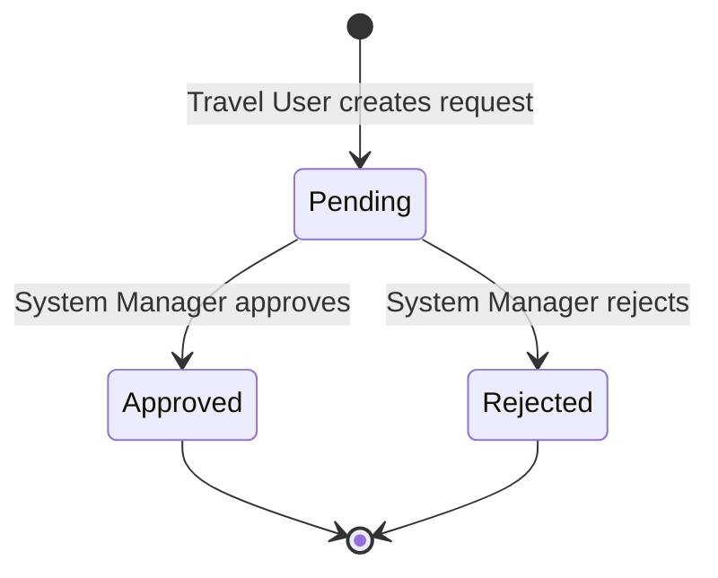

# Travel Request Management

A Frappe application for managing and tracking travel requests with built-in validations, client-side UX enhancements, and server-side business rule enforcement.

**Level:** Beginner | **Focus:** DocType Creation, Client Script, Server Script, and Validations

---

## Table of Contents

- [Submission Requirements](#submission-requirements)
  - [1. DocType Fields](#1-doctype-fields)
  - [2. Client Script Source Code](#2-client-script-source-code)
  - [3. Server Script Source Code](#3-server-script-source-code)
  - [4. Screenshots of Validation Errors](#4-screenshots-of-validation-errors)
  - [5. Screenshot of Successfully Saved Travel Request](#5-screenshot-of-successfully-saved-travel-request)
- [Features](#features)
- [Workflow](#workflow)
  - [Status Flow](#status-flow)
  - [Roles & Permissions](#roles--permissions)
  - [Role Behavior Details](#role-behavior-details)
  - [Request Lifecycle](#request-lifecycle)
- [DocType Specification](#doctype-specification)
  - [Fields Table](#fields-table)
  - [Select Field Options](#select-field-options)
- [Validations & Business Logic](#validations--business-logic)
- [Expected Validation Results](#expected-validation-results)
- [Installation](#installation)
- [Project Structure](#project-structure)
- [Contributing](#contributing)
- [License](#license)

---

## Submission Requirements

This section contains all deliverables required for the Frappe Developer Practical Assignment.

### 1. DocType Fields

The **Travel Management Request** DocType is designed with all required fields organized cleanly in a two-column layout.


#### Fields Breakdown

| Field Label          | Field Type   | Fieldname              | Mandatory | Read Only | Description / Options                            |
| -------------------- | ------------ | ---------------------- | :-------: | :-------: | ------------------------------------------------ |
| Applicant Name       | Data         | `applicant_name`       | Yes       | No        | Name of the person requesting travel              |
| Travel Type          | Select       | `travel_type`          | Yes       | No        | Options: `Official`, `Personal`, `Emergency`     |
| From Date            | Date         | `from_date`            | Yes       | No        | Travel start date (defaults to today)             |
| To Date              | Date         | `to_date`              | Yes       | No        | Travel end date                                   |
| Status               | Select       | `status`               | Yes       | Conditional | Options: `Pending`, `Approved`, `Rejected` (Permlevel 1) |
| Total Days           | Int          | `total_days`           | No        | Yes       | Auto-calculated duration in days (inclusive)      |
| Destination          | Data         | `destination`          | Yes       | No        | Destination location                              |
| Number of Travellers | Int          | `number_of_travellers` | Yes       | No        | Total number of travellers (Min: 1, Max: 10)      |
| Estimated Cost       | Currency     | `estimated_cost`       | Yes       | No        | Estimated expense (Min: > 0, Max: ₹1,00,000)      |
| Purpose              | Small Text   | `purpose`              | No        | No        | Reason / purpose for travel                       |

---

### 2. Client Script Source Code

**File Path:** `travel_request_management/travel_request_management/doctype/travel_management_request/travel_management_request.js`

```javascript
// Copyright (c) 2026, sanjay and contributors
// For license information, please see license.txt

frappe.ui.form.on('Travel Management Request', {

    // 1. Set default values when creating a new request
    onload: function(frm) {

        if (frm.is_new()) {

            // Set From Date to today
            if (!frm.doc.from_date) {
                frm.set_value('from_date', frappe.datetime.get_today());
            }

            // Set Status to Pending
            if (!frm.doc.status) {
                frm.set_value('status', 'Pending');
            }
        }
    },

    // 2. Make saved requests read-only for Travel User
    refresh: function(frm) {

        let user_roles = frappe.user_roles || [];

        let is_travel_user = user_roles.includes('Travel User');
        let is_system_manager = user_roles.includes('System Manager');

        // Only restrict existing requests for Travel User
        // System Manager must remain able to edit all fields
        if (is_travel_user && !is_system_manager && !frm.is_new()) {

            let fields = [
                'applicant_name',
                'travel_type',
                'from_date',
                'to_date',
                'destination',
                'number_of_travellers',
                'estimated_cost',
                'purpose',
                'status',
                'total_days'
            ];

            fields.forEach(function(field) {
                frm.set_df_property(field, 'read_only', 1);
            });

            frm.refresh_fields();
        }

        if (is_system_manager && !frm.is_new()) {

            let fields = [
                'applicant_name',
                'travel_type',
                'from_date',
                'to_date',
                'destination',
                'number_of_travellers',
                'estimated_cost',
                'purpose',
                'total_days'
            ];

            fields.forEach(function(field) {
                frm.set_df_property(field, 'read_only', 1);
            });

            if (
                frm.doc.status === 'Approved' ||
                frm.doc.status === 'Rejected'
            ) {
                frm.set_df_property('status', 'read_only', 1);
            } else {
                frm.set_df_property('status', 'read_only', 0);
            }

            frm.refresh_fields();
        }
    },

    // 3. Validate fields before saving
    validate: function(frm) {

        // From Date cannot be earlier than today
        if (frm.doc.from_date &&
            frm.doc.from_date < frappe.datetime.get_today()) {

            frappe.msgprint({
                title: __('Invalid From Date'),
                message: __('From Date cannot be earlier than today.'),
                indicator: 'red'
            });

            frappe.validated = false;
            return;
        }

        // To Date must be greater than or equal to From Date
        if (frm.doc.from_date && frm.doc.to_date &&
            frm.doc.to_date < frm.doc.from_date) {

            frappe.msgprint({
                title: __('Invalid To Date'),
                message: __('To Date must be greater than or equal to From Date.'),
                indicator: 'red'
            });

            frappe.validated = false;
            return;
        }

        // Number of Travellers must be at least 1
        if (!frm.doc.number_of_travellers ||
            frm.doc.number_of_travellers < 1) {

            frappe.msgprint({
                title: __('Invalid Number of Travellers'),
                message: __('Number of Travellers must be at least 1.'),
                indicator: 'red'
            });

            frappe.validated = false;
            return;
        }

        // Estimated Cost must be greater than zero
        if (!frm.doc.estimated_cost ||
            frm.doc.estimated_cost <= 0) {

            frappe.msgprint({
                title: __('Invalid Estimated Cost'),
                message: __('Estimated Cost must be greater than zero.'),
                indicator: 'red'
            });

            frappe.validated = false;
            return;
        }
    },

    // 4. Display message when Emergency travel is selected
    travel_type: function(frm) {

        if (frm.doc.travel_type === 'Emergency') {

            frappe.msgprint({
                title: __('Emergency Travel'),
                message: __('You have selected Emergency travel. Please ensure that the travel details are accurate.'),
                indicator: 'orange'
            });
        }
    }

});
```

---

### 3. Server Script Source Code

#### DocType Controller (Python)

**File Path:** `travel_request_management/travel_request_management/doctype/travel_management_request/travel_management_request.py`

```python
# Copyright (c) 2026, sanjay and contributors
# For license information, please see license.txt

import frappe
from frappe.model.document import Document
from frappe.utils import getdate, today, date_diff


class TravelManagementRequest(Document):

    def before_insert(self):
        """Set default status when creating a new request."""
        self.status = "Pending"

    def validate(self):
        """Perform server-side validations before saving."""

        # 1. Prevent Travel Users from editing existing requests
        if not self.is_new():

            user_roles = frappe.get_roles(frappe.session.user)

            if (
                "Travel User" in user_roles
                and "System Manager" not in user_roles
                and frappe.session.user != "Administrator"
            ):
                frappe.throw(
                    "You are not allowed to modify an existing travel request."
                )

        # 2. Validate Applicant Name
        if not self.applicant_name or not self.applicant_name.strip():
            frappe.throw("Applicant Name is mandatory.")

        # 3. Validate Destination
        if not self.destination or not self.destination.strip():
            frappe.throw("Destination is mandatory.")

        # 4. Validate From Date
        if not self.from_date:
            frappe.throw("From Date is mandatory.")

        # 5. Validate To Date
        if not self.to_date:
            frappe.throw("To Date is mandatory.")

        from_date = getdate(self.from_date)
        to_date = getdate(self.to_date)
        current_date = getdate(today())

        # From Date cannot be earlier than today
        if from_date < current_date:
            frappe.throw("From Date cannot be earlier than today.")

        # To Date cannot be earlier than From Date
        if to_date < from_date:
            frappe.throw("To Date cannot be earlier than From Date.")

        # 6. Calculate Total Days (inclusive)
        self.total_days = date_diff(to_date, from_date) + 1

        # 7. Validate Number of Travellers
        if (
            self.number_of_travellers is None
            or self.number_of_travellers < 1
        ):
            frappe.throw("Number of Travellers must be at least 1.")

        if self.number_of_travellers > 10:
            frappe.throw("Number of Travellers cannot exceed 10.")

        # 8. Validate Estimated Cost
        if self.estimated_cost is None or self.estimated_cost <= 0:
            frappe.throw("Estimated Cost must be greater than zero.")

        if self.estimated_cost > 100000:
            frappe.throw("Estimated Cost cannot exceed ₹1,00,000.")
```

#### Frappe Server Script (DocType Event) Equivalent

- **Script Type:** `DocType Event`
- **Reference DocType:** `Travel Request` (or `Travel Management Request`)
- **Event:** `Before Save`

```python
# Server Script - DocType Event (Before Save)
from frappe.utils import getdate, today, date_diff

# 1. Applicant Name cannot be empty
if not doc.applicant_name or not doc.applicant_name.strip():
    frappe.throw("Applicant Name is mandatory.")

# 2. Destination cannot be empty
if not doc.destination or not doc.destination.strip():
    frappe.throw("Destination is mandatory.")

# 3. Date Validations
if not doc.from_date:
    frappe.throw("From Date is mandatory.")

if not doc.to_date:
    frappe.throw("To Date is mandatory.")

from_date = getdate(doc.from_date)
to_date = getdate(doc.to_date)
current_date = getdate(today())

if from_date < current_date:
    frappe.throw("From Date cannot be earlier than today.")

if to_date < from_date:
    frappe.throw("To Date cannot be earlier than From Date.")

# 4. Automatically calculate travel duration and store in Total Days
doc.total_days = date_diff(to_date, from_date) + 1

# 5. Number of Travellers validation (Min: 1, Max: 10)
if doc.number_of_travellers is None or doc.number_of_travellers < 1:
    frappe.throw("Number of Travellers must be at least 1.")

if doc.number_of_travellers > 10:
    frappe.throw("Number of Travellers cannot exceed 10.")

# 6. Estimated Cost validation (Min: > 0, Max: ₹1,00,000)
if doc.estimated_cost is None or doc.estimated_cost <= 0:
    frappe.throw("Estimated Cost must be greater than zero.")

if doc.estimated_cost > 100000:
    frappe.throw("Estimated Cost cannot exceed ₹1,00,000.")
```

---

### 4. Screenshots of Validation Errors

#### A. Mandatory Fields Validation Error (Applicant Name & Destination)
When trying to save a request without filling in mandatory fields, Frappe prompts the user with missing field requirements:


#### B. Number of Travellers Validation Error
When Number of Travellers is set to `0` or less:


#### C. Estimated Cost Validation Error
When Estimated Cost is empty or less than or equal to `0`:


#### D. Emergency Travel Informational Notification
When Travel Type is selected as `Emergency`, an instant warning alert is displayed to the user:


---

### 5. Screenshot of Successfully Saved Travel Request

#### Form View (Successfully Saved Record `TMR-000011`)
The record saves successfully with calculated **Total Days = 5** and status automatically initialized to **Pending**:


#### List View
List view displaying travel requests in various workflow stages (`Pending`, `Approved`, `Rejected`):


---

## Features

- Custom **Travel Management Request** DocType with comprehensive fields
- **Client-side validations** for instant user feedback
- **Server-side validations** to enforce critical business rules
- Automatic **travel duration calculation** (Total Days)
- Auto-status assignment for new requests (`Pending`)
- Emergency travel type notification
- **Role-based access control** (Travel User & System Manager)
- Status-locked editing for finalized requests

---

## Workflow

### Status Flow



**How it works:**

1. **New requests** are automatically created with status `Pending`.
2. Only **System Manager** can change the status (via `permlevel` 1 permission on the `status` field).
3. Once a request is `Approved` or `Rejected`, the status field becomes **read-only** -- no further changes are allowed.

### Roles & Permissions

| Role           | Create | Read | Write          | Delete | Status Edit        |
| -------------- | :----: | :--: | :------------: | :----: | :----------------: |
| System Manager | Yes    | Yes  | Yes            | Yes    | Yes (while Pending)|
| Travel User    | Yes    | Yes  | Yes (new only) | No     | No                 |

### Role Behavior Details

**Travel User:**
- Can **create** new travel requests.
- Can fill in all fields when creating a new request.
- **Cannot edit** any field on an existing (saved) request -- all fields become read-only after first save.
- Cannot delete requests.

**System Manager:**
- Can **create** and **delete** travel requests.
- On existing requests, all data fields (applicant name, dates, destination, etc.) are **read-only** to preserve the original submission.
- Can **change the Status** field (Pending -> Approved / Rejected) as long as it is still `Pending`.
- Once status is `Approved` or `Rejected`, the status field locks and becomes read-only.

### Request Lifecycle

1. **Travel User** creates a new request -- Status is auto-set to `Pending`, From Date defaults to today.
2. If `Emergency` travel type is selected, an informational alert is displayed.
3. Client-side and server-side validations run on save.
4. **System Manager** reviews the request and sets Status to `Approved` or `Rejected`.
5. After approval/rejection, the request is fully locked -- no further edits.

---

## DocType Specification

### Fields Table

| Field Label          | Field Type | Fieldname             | Description                                      |
| -------------------- | ---------- | --------------------- | ------------------------------------------------ |
| Applicant Name       | Data       | `applicant_name`      | Name of the person requesting travel              |
| Travel Type          | Select     | `travel_type`         | Type of travel (Official / Personal / Emergency)  |
| From Date            | Date       | `from_date`           | Travel start date                                 |
| To Date              | Date       | `to_date`             | Travel end date                                   |
| Destination          | Data       | `destination`         | Travel destination                                |
| Number of Travellers | Int        | `number_of_travellers`| Count of people travelling                        |
| Estimated Cost       | Currency   | `estimated_cost`      | Estimated cost of the trip                        |
| Purpose              | Small Text | `purpose`             | Reason / purpose for the travel                   |
| Status               | Select     | `status`              | Request status (Pending / Approved / Rejected)    |
| Total Days           | Int        | `total_days`          | Auto-calculated travel duration in days           |

### Select Field Options

- **Travel Type:** `Official`, `Personal`, `Emergency`
- **Status:** `Pending`, `Approved`, `Rejected`

---

## Validations & Business Logic

### Client Script (Front-end)

The client script runs in the browser and provides instant feedback:

1. **From Date** must not be earlier than today's date.
2. **To Date** must be greater than or equal to From Date.
3. **Number of Travellers** must be at least 1.
4. **Estimated Cost** must be greater than zero.
5. When **Travel Type** is set to `Emergency`, an informational message is displayed.
6. **Status** is automatically set to `Pending` when creating a new record.

### Server Script (Back-end)

The server script runs on `Before Save` event and independently enforces business rules:

- **Script Type:** DocType Event
- **Reference DocType:** Travel Request
- **Event:** Before Save

**Rules:**

1. **Applicant Name** cannot be empty.
2. **Destination** cannot be empty.
3. **To Date** cannot be earlier than From Date.
4. **Number of Travellers** cannot exceed 10.
5. **Estimated Cost** cannot exceed ₹1,00,000.
6. **Total Days** is automatically calculated from From Date and To Date (`date_diff(to_date, from_date) + 1`).

> **Important:** Client-side validation improves user experience, but server-side validation independently enforces critical business rules.

---

## Expected Validation Results

| Test Case                      | Expected Result   | Status            |
| ------------------------------ | ----------------- | ----------------- |
| From Date = yesterday          | Validation error  | Enforced (Client & Server) |
| To Date before From Date       | Validation error  | Enforced (Client & Server) |
| Number of Travellers = 0       | Validation error  | Enforced (Client & Server) |
| Number of Travellers = 5       | Allowed           | Valid             |
| Number of Travellers = 12      | Validation error  | Enforced (Server) |
| Estimated Cost = 0             | Validation error  | Enforced (Client & Server) |
| Estimated Cost = ₹1,50,000     | Validation error  | Enforced (Server) |
| Travel Type = Emergency        | Display message   | Notification shown |
| Valid travel request           | Save successfully | Successfully saved |

---

## Installation

You can install this app using the [bench](https://github.com/frappe/bench) CLI:

```bash
cd $PATH_TO_YOUR_BENCH
bench get-app $URL_OF_THIS_REPO --branch develop
bench install-app travel_request_management
```

---

## Project Structure

```
travel_request_management/
├── travel_request_management/
│   ├── travel_request_management/
│   │   └── doctype/
│   │       └── travel_management_request/
│   │           ├── travel_management_request.json   # DocType definition
│   │           ├── travel_management_request.py     # Server-side controller
│   │           ├── travel_management_request.js     # Client script
│   │           └── test_travel_management_request.py
│   ├── config/
│   ├── hooks.py
│   ├── modules.txt
│   ├── patches/
│   ├── public/
│   ├── templates/
│   └── www/
├── screenshots/
│   ├── Screenshot 2026-11-04 161601.png             # Emergency alert notification
│   ├── Screenshot 2026-11-04 161627.png             # Travellers validation error
│   ├── Screenshot 2026-11-04 161638.png             # Estimated cost validation error
│   ├── Screenshot 2026-11-04 161709.png             # Missing mandatory fields error
│   ├── Screenshot 2026-11-04 161748.png             # Form view & successfully saved
│   └── Screenshot 2026-11-05 092008.png             # List view
├── pyproject.toml
└── README.md
```

---

## Contributing

This app uses `pre-commit` for code formatting and linting. Please [install pre-commit](https://pre-commit.com/#installation) and enable it for this repository:

```bash
cd apps/travel_request_management
pre-commit install
```

Pre-commit is configured to use the following tools for checking and formatting your code:

- ruff
- eslint
- prettier
- pyupgrade

---

## License

MIT
